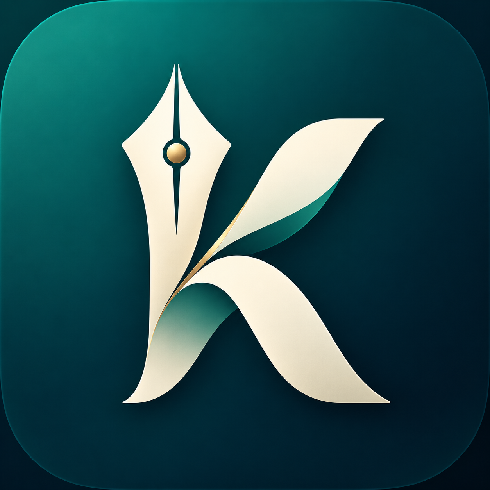

<p align="center">
  
</p>

# Kodmoz Writer

Swift ve AppKit ile geliştirilmiş, dikkatinizi dağıtmadan yazı yazmanızı sağlayan yerel macOS uygulaması. Ekranı kaplayan bir arka plan, ortalanmış bir yazı sütunu ve ihtiyaç duyduğunuzda açılan bir not menüsü sunar. Yazı, ekranın üst bölümünden başlar.

## İndir ve kur

**[En son sürümü indir](https://github.com/hasanislamoglu5361/kodmoz-writer/releases/latest)** · **[Tüm sürümler](https://github.com/hasanislamoglu5361/kodmoz-writer/releases)**

1. Release sayfasından `Kodmoz-Writer-macOS-arm64.zip` dosyasını indirin.
2. ZIP dosyasını açın.
3. `Kodmoz Writer.app` uygulamasını **Applications / Uygulamalar** klasörüne taşıyın.
4. Uygulamayı açın ve yazmaya başlayın. Kaydet düğmesine basmanız gerekmez.

Gereksinimler: **macOS 14 veya üzeri**. Hazır paket Apple Silicon (M serisi) Mac içindir. Intel Mac kullanıcıları kaynak kodunu kendi Mac’lerinde derleyebilir. Paket ad hoc imzalıdır; Apple Developer ID imzası ve notarizasyon içermez.

## Özellikler

- **Tam ekran yazma:** Açılışta ekranın tamamını kaplar. Başlık ve araç çubuğu yazma alanında görünmez.
- **Üstten başlayan metin:** Yazı sütunu yatayda ortalanır. İlk satır üstten 48 punto boşlukla başlar. Sol iç boşluk ve satır kenar payı harflerin kırpılmasını önler.
- **Gizli not menüsü:** Fareyi ekranın sol kenarına getirin veya `⇧⌘L` kullanın. Not seçin, yeni bir yazı açın ya da arka plan ayarlarına gidin. Fareyi yazı alanına taşıyınca menü gizlenir.
- **Birden fazla not:** `⌘N` ile yeni not oluşturun. Not başlıkları ilk dolu satırdan otomatik alınır.
- **Anında otomatik kayıt:** Her metin değişikliği ve seçili metne uygulanan biçimlendirme, atomik dosya yazımıyla kaydedilir. Not değiştirirken ve uygulamadan çıkarken de kayıt yapılır. Kayıt başarısız olursa uygulama hata gösterir.
- **10 hazır renk:** Gece, Kâğıt, Orman, Okyanus, Lavanta, Kum, Gül, Kömür, Adaçayı, Beyaz.
- **10 hazır görsel:** Sisli Dağlar, Gün Batımı, Çam Ormanı, Kum Tepeleri, Gece Göğü, Sakin Deniz, Lavanta Tepeleri, Karlı Zirveler, Sonbahar, Ay Işığı. Bunlar uygulama içinde çizilen, çevrimdışı çalışan illüstrasyonlardır.
- **Özel arka plan:** Kendi renginizi veya yerel görselinizi seçin. Görseller oranları korunarak ekranı doldurur; gerekirse kenarları kırpılır.
- **Otomatik kontrast:** Renklerde siyah veya beyaz yazı kontrasta göre seçilir. Görseller, beyaz metnin okunabilmesi için karartılır.
- **Bağlantı ekleme:** `⌘L` ile seçili metne bağlantı ekleyin veya yeni bağlantı metni girin. `https`, `http` ve `mailto` desteklenir. ⌘ ile tıklayarak açın. Bağlantılar otomatik kayda ve RTF dışa aktarıma dahildir.
- **Zengin metin:** Kalın, italik, altı çizili, yazı tipi ve punto seçimi; geri alma/yineleme.
- **RTF dışa aktarma:** Metin biçimlendirmesini koruyarak seçtiğiniz konuma aktarın.
- **Yerel çalışma:** Hesap, sunucu ve internet bağlantısı gerektirmez. Uygulama notlarınızı bir sunucuya göndermez.

## Klavye kısayolları

| Kısayol | İşlev |
| --- | --- |
| `⌘N` | Yeni yazı |
| `⌘L` | Bağlantı ekle/düzenle |
| `⇧⌘L` | Not menüsünü aç/kapat |
| `⌘,` | Arka plan ve görünüm |
| `⌘B` | Kalın |
| `⌘I` | İtalik |
| `⌘U` | Altı çizili |
| `⌘T` | Yazı tipi ve punto |
| `⌘S` | RTF dışa aktar; normal kayıt zaten otomatiktir |
| `⌘Z` / `⇧⌘Z` | Geri al / yinele |
| `⌃⌘F` | Tam ekranı aç/kapat |
| `⌘Q` | Çık |

## Notlar nerede saklanır?

Notlar `~/Library/Application Support/FocusWriter/Notes/` altında ayrı `.rtf` dosyaları olarak saklanır. Eski sürümlerdeki `Draft.rtf`, ilk açılışta bir nota kopyalanır ve özgün dosya korunur. Uygulamanın adı değişse de mevcut notlara ve tercihlere erişebilmek için veri klasörü ve bundle kimliği korunmuştur.

Özel görsel aynı ana klasöre `Background.image` olarak kopyalanır; özgün dosyayı taşımanız arka planı bozmaz. Son açık not ve arka plan tercihi yeniden açılışta yüklenir. Yedekleme için bu klasörü kopyalayabilirsiniz. Not silme ve bulut eşitleme bu sürümde bulunmaz.

## Kaynaktan derleme

Apple Command Line Tools ve Swift 6 veya üzeri gerekir. Üçüncü taraf paket bağımlılığı yoktur.

```sh
git clone https://github.com/hasanislamoglu5361/kodmoz-writer.git
cd kodmoz-writer
bash build-app.sh
open 'dist/Kodmoz Writer.app'
```

Derleme çıktısı `dist/Kodmoz Writer.app` konumuna yazılır. Script, simgeyi pakete ekler ve uygulamayı yerel kullanım için ad hoc imzalar. Scripti `bash` ile çalıştırmak, indirmede yürütme izni korunmadığında da çalışır.

## Proje yapısı

| Dosya | İçerik |
| --- | --- |
| `main.swift` | AppKit arayüzü, notlar, kayıt, biçimlendirme ve arka planlar |
| `Package.swift` | Swift Package Manager yapılandırması |
| `build-app.sh` | Release derleme, `.app` paketleme ve yerel imzalama |
| `AppIcon.png` | Kodmoz Writer logosu |
| `AppIcon.icns` | macOS uygulama simgesi |
| `RELEASE_NOTES.md` | Sürüm değişiklikleri |

## 1.1 sürümü

Tam ekran pencere sınırları düzeltildi. Arka plan tüm ekranı doldurur; yazı sütunu bağımsız biçimde ortalanır. Yazı üstten başlar ve yatay kaydırmanın ilk harfi kırpması engellenir. Gizli sol menü, çoklu notlar, her değişiklikte kayıt ve Kodmoz Writer logosu eklendi.

## GitHub CLI ile yayınlama

Depoya yazma yetkisi olan GitHub hesabıyla `gh auth login` yaptıktan sonra:

```sh
bash publish.sh
```

Script önce GitHub bağlantısını doğrular, uygulamayı derler, yalnızca kaynak dosyaları ve simgeyi ayrı bir Git çalışma alanına alır, `main` dalına ve `v1.1.0` etiketine gönderir. Ardından ZIP dosyasını GitHub Release’e yükler. Kişisel notlar, özel arka planlar, derleme önbelleği ve çalışma klasörünün diğer dosyaları kaynak depoya eklenmez. Uzak dal ile geçmiş uyuşmazsa script durur; force push yapmaz. Release bağlantısı yayın tamamlandıktan sonra çalışır.
